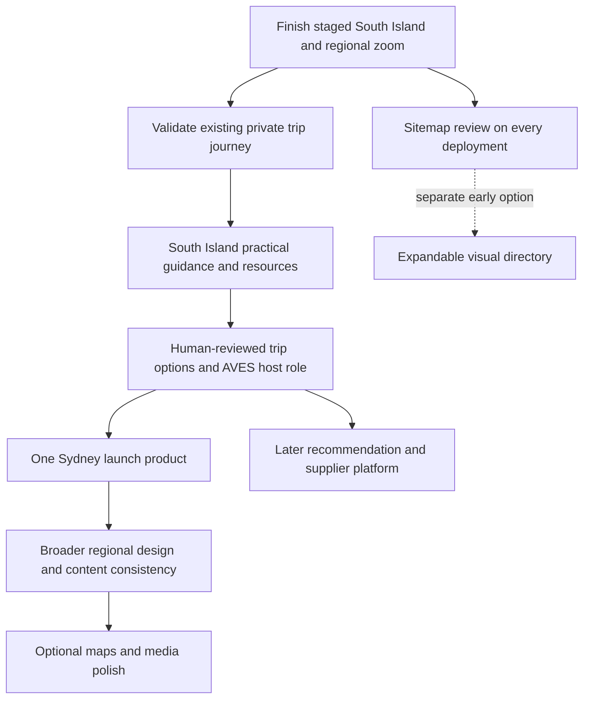

# AVES — agile design and implementation plan

**Latest release — 9 November 2026: B3 practical South Island planning published and paused.** Source8f6146e / dpl_3NuUMATbo9HWAbQHGQ4pLx7QncDf; AU unchanged6ba7fee. Desktop/phone,15 targeted tests, TypeScript/build and live human/XML sitemap checks passed. See [RELEASE-2026-11-09-SOUTH-ISLAND-PLANNING.md](RELEASE-2026-11-09-SOUTH-ISLAND-PLANNING.md). Next proposed B4 curated resources: Sol medium recommended; wait for selection. This overrides older next-step/state notes.

**Latest checkpoint — 9 November 2026: B2 content-gap inventory complete; paused.** See [SOUTH-ISLAND-CONTENT-GAPS.md](SOUTH-ISLAND-CONTENT-GAPS.md). Next proposed B3 is a compact practical South Island guidance section, Sol medium recommended; do not begin automatically. Business direction confirmed: a sustainable-tourism marketplace connecting birds/habitats/places to verified local experiences, with AVES human coordination. Validate through South Island then Sydney; marketplace infrastructure remains separate later discovery. This supersedes older next-step instructions.

**Latest checkpoint — 9 November 2026: B1 private NZ brief passed live and is paused.** Save/reopen/edit, retained bird choices, explicit sharing and owner receipt verified with synthetic data;103 targeted tests passed. Email service accepted notification; Gmail delivery not independently verified. No app fix/deployment needed. See [CHECKPOINT-2026-11-09-NZ-BRIEF.md](CHECKPOINT-2026-11-09-NZ-BRIEF.md). Next proposed B2 content-gap inventory: Luna low recommended, wait for owner. Featured-place map overlays034 and relevant historical/extinct display cleanup017 remain queued. This overrides older next-step instructions below.

**Current release — 9 November 2026: published and paused.** South Island/regional zoom is live: source5847eb7 / dpl_GMPLFwPviWsLq73i9JJBjCNvkaja; AU6ba7fee / dpl_9ZrHC1jyd3SGzMeVn248kcFBwmcv. Desktop/mobile and live sitemap checks passed within the limits recorded in [RELEASE-2026-11-09-SOUTH-ISLAND.md](RELEASE-2026-11-09-SOUTH-ISLAND.md). A1 is complete; B1 private-brief verification is the next proposed increment, not started. Announce model/effort before resuming; Sol medium recommended. This notice overrides older staged/paused status below.

Updated 9 November 2026 (Sydney). **Planning-only checkpoint: publishing is on hold.** The owner interrupted the resumed release to review this plan. Wait for one selected increment; do not execute this whole backlog. This replaces earlier sequencing/effort tables, not the detailed requirements in ROADMAP-DETAILS.md or stable IDs in AVES-CHANGE-INBOX.md.

## Baseline and historical planning context

| State | Global / Colombia / NZ | Australia / shared accounts |
| --- | --- | --- |
| Branch | `webmaster/readiness-2026-11-05` | `australia/preview` |
| Published app | `5847eb7` | `6ba7fee` |
| Published source commit | `5847eb7` | `6ba7fee` |
| Published deployment | `dpl_GMPLFwPviWsLq73i9JJBjCNvkaja` | `dpl_9ZrHC1jyd3SGzMeVn248kcFBwmcv` |

Provider/live state was last verified 8 November, not rechecked during this documentation-only session. Documentation heads may be newer. PAUSED-CHECKPOINT-2026-11-08.md holds exact stage URLs, remaining checks and the isolated untested pricing draft. Both working trees were clean before this update.

Delivered: shared accounts/Google login, private plans/requests/owner proposals, NZ brief/bird selection, country dividers, Equal Earth homepage explorer/cards, speaker cue, transparent Info and adaptive focal framing. Do not rebuild them. Dedicated South Island and deeper regional zoom are built/pushed/staged, not yet live. A real guest trial remains pending. The former 40–60% remaining figure was subjective; do not present it as measured progress or quota. The future platform is unsized.

## Outcome order

Security or essential-journey failures take priority. Sitemap accuracy is a release gate immediately; its tree interface is an independent release, not a reason to rebuild the ready candidates. NZ trip usefulness precedes decoration, then Sydney. Arrows indicate dependencies/proposed order, not permission to implement everything.

## Design contract

- Keep emerald/mint, airy white space, thin AVES lettering and bird/landscape country marks. Branding/name choices remain separate (032).
- Reuse one content-driven explorer pattern: map, local collection, discreet over-image controls and translucent Info. Content changes by page; avoid separate carousel state machines. One physical shared component belongs to gated app consolidation, not each small visual release.
- Wide screens pair map/media with coordinated heights, responsive width and the existing divider; narrow screens stack media first, map second. Choose breakpoints by usable card width. Test intermediate widths; do not claim physical foldable/phone tests unless performed.
- Preserve existing focal-point cover scaling, edge clamping, no blank side padding and short-frame Info scrolling. Test regressions rather than recreating these delivered behaviors.
- Use real geography, local birds/calls/rights, clear collection context and Back controls. Country-to-region selection updates previews; complete guides retain canonical URLs. Keep country navigation maps until optional local ecosystem views demonstrate value.
- Vertical hierarchy: world → country → region → relevant guides/experiences/resources. Horizontal journeys connect birds, habitats, activities and the private brief/My Trips. Logical nesting does not require changing established URLs or making every content item a new page.

## Model recommendations and usage discipline

**Before EVERY increment, tell the owner which model and reasoning setting to use, or explicitly say to keep the current one.** Give one short reason. When escalation is needed, explain it at a checkpoint before recommending the switch. Record chosen/recommended settings in the checkpoint. The owner selects the model in the app where no switch tool exists; never claim a switch happened automatically. Avoid unnecessary switches within a small release.

| Work | AVES starting recommendation | Escalation |
| --- | --- | --- |
| Bounded documentation, inventory, supplied-source copy | Luna, low | Sol medium if ambiguity affects correctness |
| React/layout/data wiring and normal release work | GPT-6.1 Sol, medium | High effort or Astra for an evidenced difficult defect |
| Defined desktop/mobile browser QA | Keep Sol medium; Terra medium is an option if offered and QA becomes a separate checkpoint | Preserve findings if code analysis is needed |
| Privacy/auth/data-model design, consolidation or conflicting evidence | Astra, medium, for the bounded decision/review | Higher effort only for an unresolved issue |
| After diagnosis | Return to the normal task model | No default extra-high/max/Ultra or premium speed |

These are project recommendations based on [official model guidance](https://developers.openai.com/api/docs/guides/model-selection), reviewed 9 November. [Official allowance guidance](https://learn.chatgpt.com/docs/pricing) says usage depends on model/context/reasoning/tools/retrieval/caching. API prices do not convert to weekly ChatGPT allowance. No exact quota percentage, multiplier or guaranteed saving is known. Use settings actually offered; do not buy credits, enable premium speed or add an API automatically.

Efficiency rules:

1. One selected outcome in progress. Read the short execution prompt/current checkpoint, relevant files and selected acceptance criteria only; do not reread the whole conversation or rediscover delivered features.
2. Open with a task card: outcome, exclusions, branch/baseline, dependencies, effort, recommended model/setting, checks, publish/rollback target and pause point. Keep new ideas in the inbox.
3. Reuse ready builds and recorded evidence. Do not rebuild unchanged code because a docs head is newer. If a real fix changes the candidate, test/build that revision and record its exact target.
4. Batch independent reads/searches, keep edits/deployments/adaptive checks sequential. Research changing facts once per content batch; save source/date/licence. No parallel agents unless explicitly requested or required.
5. Targeted checks while editing; required app checks once at release; broaden only for changes, failure or unresolved risk. Docs-only sync needs diff/link/mirror checks, not app builds/browser repeats.
6. Review touched code/comments for clarity, redundancy and verified-unused legacy logic; explain intent for a beginner. Preserve necessary migrations/history. Do not comment every syntax token or add a repository-wide cleanup to a small task.
7. Checkpoint/sync/pause after each selected increment and before switching models/devices/chats. If the owner reports low allowance, choose a smaller outcome; do not pretend to see their meter.

## Small release cards

Effort: **1 very small; 2 small; 3 medium; 5 substantial; 8+ split before starting.** These compare scope including proportionate checks, publication/live QA when applicable, GitHub sync and pause. They are not credits, hours, percentages or linear cost ratios. Re-estimate after discovery.

### A. Finish the staged release

| Card / IDs | Outcome and dependency | Effort / model | Acceptance and stop |
| --- | --- | --- | --- |
| A1 — 007 / 012a and regional zoom | Finish exact candidates above; no new feature | 2 remaining / Sol medium | Source stage desktop/390/320px and short Info frames; NZ Back focus, CO marker hiding, heading separator, South guide/canonical/old anchor/sitemap, calls/Info/wishlist/divider and country/region links. Reuse completed all-23-region local/AU-stage evidence. Recheck targets, promote AU then source, verify live, sync and pause. |

Already passed: 112 source + 273 AU tests (385 total), final 32 focused source checks, TypeScript and both builds. Source hosted QA and all post-promotion live checks remain. Do not repeat completed checks without a changed revision or concern. Physical-device/OS-preference testing remains unverified unless actually performed.

### B. Make South Island useful for the trip

| Card / IDs | Smallest useful outcome | Depends on | Effort / model | Acceptance |
| --- | --- | --- | --- | --- |
| B1 — 004 / 005 | Recheck existing private brief with labelled synthetic data | A1 | 2 / Sol medium | Save/reopen/edit, stable bird IDs, explicit share, owner access/notification, anonymous/cross-account isolation. No second planner. A QA pass is not Peter/Lisa's guest trial. |
| B2 — 016 discovery | One content-gap/source inventory against Colombia | A1; reuse B1 findings | 1 / Luna low | Rank trip-blocking gaps; reuse current content. Confirm actual dates/year/preferences privately before personalised options. Docs only. |
| B3 — 016 guidance | One practical South Island content batch | B2 | 3 / Sol medium | Gateways, realistic travel/rest, season/access/weather, comfort/accessibility, food/culture, wildlife/biosecurity and official links; changing facts checked, no fictional availability/prices. |
| B4 — 016 resources | A small curated resource collection | B2; independent of B3 | 2 / Sol medium | Useful reading/conservation plus podcasts/documentaries/YouTube, working links, lawful embeds, concise purpose; no scrape/download library. |
| B5 — 023 / 030 | Private balanced trip options and host responsibilities | B1, relevant B3 facts, private preferences | 3 / Sol medium; Astra only for a bounded review | Birds → habitats → nearby rest/food/culture/adventure, feasible pacing and alternatives. Host reviews AI drafts and coordinates/accompanies/storytelling where agreed. No outreach/bookings/invented legends. Guest trial is a user handoff. |
| B6 — 017 | Hide extinct NZ entries while preserving old briefs | B1 baseline | 2 / Sol medium | Keep living threatened/rare species, stable IDs/provenance and compatible validation; update scope/counts, no destructive deletion. |
| B7 — 025 | One reliable checklist facet at a time | B6 or explicit compatibility plan | 2 each / Sol medium | Origin first; distinguish introduced/invasive, migration/breeding/feeding; source place/season and unknowns, preserve filtered-out selections. Data enrichment separately. |

B3/B4 are independent publishable batches. Filters, a large resource library or full NZ coverage do not block using the existing private tool. Sydney can begin after minimum useful guidance and a reviewed planning journey.

### C. Sydney is the next commercial focus

| Card / IDs | Outcome | Depends on | Effort / model | Acceptance |
| --- | --- | --- | --- | --- |
| C1 — 024 / 023 | One Sydney itinerary outline and alternatives | Minimum useful B1–B5 | 2 / Sol medium | Reuse NSW/planning/quote foundations. Kayak/birding/Blue Mountains/Royal NP/food/culture/Opera House/wellness/whales are ideas, not confirmed inclusions. |
| C2 — 024 / 030 | Provider, route and operations validation | C1 | 3 / Sol medium | Actual relationships, season/dates, costs/capacity, transport, accessibility and sustainability evidence; private supplier details and clear host role. No contact unless instructed. |
| C3 — 024 | Reviewed inquiry/quote product | C2 and owner-reviewed scope | 3 / Sol medium | Honest inclusions/exclusions, working private request/receipt and responsive/accessibility checks; no instant-booking claim. Ads/spend/commitments separate. |

### D. Design/navigation consistency — separate pilots

| Card / IDs | Outcome | Dependency / acceptance | Effort / model |
| --- | --- | --- | --- |
| D1 — 033 | Sitemap gate now; expandable public tree separately | Section below; after A1 when selected. Can be an early independent release, not a South Island prerequisite | Gate in every release; tree 3 / Sol medium |
| D2 — 012c | Align all three homepage map cards | Full names/callouts, matching palette/borders/framing/focus/credits, true shapes and planning-region/state/island distinctions; no invented boundaries | 3 / Sol medium |
| D3 — 007 / 012a / 012b | One region/template pilot, South Island then NSW | Same duo/divider/Info/local calls; eligible text-only bird grids reuse carousel without duplicate hero media. North/Rakiura separately; reuse D2 decisions | 3 per template; re-estimate rollout / Sol medium |
| D4 — 018 / 019 | Collection title, then species-total cue | Actual collection context; sourced dated comparable totals, distinct from photo count or expected sightings. Accessible labels alone do not imply visible title complete | 1–2 each / Luna copy, Sol wiring |
| D5 — 027 | Remove public experience-price teasers | Review isolated draft5979b8b; retain private priced proposals/data, remove public metadata teasers, reuse AU quote-only pattern | 2 / Sol medium |
| D6 — 028 | Carousel-based credits page | Reuse viewer; full author/licence/modification info, recording anchors and accessible non-photo directory; no new state machine | 3 / Sol medium |

### E. Retained content/media/map work — after readiness

| IDs | Independently bounded outcome | Dependencies and limits | Effort / model |
| --- | --- | --- | --- |
| 001 / 002 | One editorial or Colombian bird-variety batch | Shared coverage/source matrix; less repetition and unsupported claims, more region-specific birds, complete rights/ranges | 3 per batch / Sol medium |
| 010 / 022 | One cultural/totemic or Māori-name pronunciation pilot | Community/native-speaker evidence/permission, diacritics, acknowledgement/credits, coordinated audio; no invented endorsement | 2–3 / Sol medium |
| 003b | Ecology definitions/legend, then each real layer | Megadiverse countries AND biodiversity hotspots, authoritative licensed geometry, NZ hotspot context, distinguish ecology from offerings, Equal Earth | 2 discovery; 3–5 per layer / Sol medium |
| 029 | Selected-country recentering/rotation pilot | Genuine Equal Earth central-meridian/antimeridian handling, not spinning/stretching SVG; Back/reduced motion | 2 discovery, implementation re-estimated / Sol or Astra medium |
| 021 / 013 | City-label pilot; optional satellite/ecosystem discovery | Preserve navigation; licence/date/projection/privacy/cost/performance, disclose different local tile projection; no forced ecosystem replacement | 2 discovery, implementation unsized / Sol medium |
| 031 inventory | Identify AVES YouTube uploads/rights/masters | Start old page backgrounds; exact owner channel not yet identified; resource embeds not assumed owned or 8K | 1–2 / Luna low |
| 031 player | One authorised clip in existing viewer | Inventory first; poster/click-to-play, context/credits, accessibility, loading/audio cleanup and phone performance | 3 / Sol medium |
| 031 hosting | Compare embeds/native adaptive/hybrid | Use pilot evidence, retain YouTube discovery; secure masters/web renditions, actual cost/privacy, no raw 8K default/Git binaries/new spend | 2 comparison; migration separately sized / Sol medium |
| 015 | One map/photo flip, then optional photo/Info flip | Uniform foundations/local media first, hidden-face focus/audio, touch and reduced-motion fallback; never block planning | 3 per pilot / Sol medium |
| 026 | Only green birds flips to AVES | Stable heading, accessible text/touch/reduced motion; no navigation change | 1–2 / Sol medium |
| 014 | es-CO foundation, then page/form batches | Natural Colombian Spanish, retain English/URLs/metadata/forms/help/accessibility/privacy; low priority | 2 discovery, 3 per batch / Sol medium |
| Deferred | Facebook or expired-Google-session landing separately | Preserve working Google/email/info@aves.bio; recheck provider requirements | 2–3 pilot, re-estimate / Sol medium |
| 032 | International brand decision brief | AVES English/Spanish appeal, thin marks/land connection, motmot/fairywren/kea/global peregrine; no automatic rename/domain purchase | 2 discovery / Astra medium only if needed |

### F. Platform work — discovery before promises

- **020:** unmerged PR3 is a starting draft. Inventory post-base changes; incorporate staged fixes if accepted, then unified preview → public/private/SEO/provider gates → owner-approved cutover/rollback → separately approved retirement. Size each gate. Keep shared database and established URLs/search value; never directly merge independent app branches. Astra medium for bounded architecture/privacy review; Sol medium for implementation. No cutover now.
- **004 / 005:** cross-country wishlist and safe guest/account merge before optional seen/want-to-see bingo/collaboration. Stable IDs/consent/isolation and useful questionnaire feedback first. Pilot 3–5, split again before execution.
- **023 / 030:** human-reviewed itinerary suggestions from private bird/habitat preferences before AI automation. Then verified supplier records/sustainability evidence, recommendation quality, feasibility, owner approval and auditability. Live inventory/reservations/payments are separate unsized products. No automatic booking, second database/preference model or new API by default.

## Sitemap contract — AVES-033

**Every future deployment reviews/verifies the sitemap.** If routes/hierarchy change, update the registry/tree before building; otherwise record checked/unchanged, without a cosmetic commit or false modification date. Docs-only sync is not a website deployment.

1. **Search engines:** existing `/sitemap.xml` and `/australia/sitemap.xml`, from canonical public-page registries. Exclude account/admin/API/auth/preview URLs, personal records, query variants and redirect aliases. Never set every lastModified to deployment time. A sitemap is discovery, not access control.
2. **Visitors:** `/site-map` becomes an expandable world → country → region → related-guide directory, with discreet relevant cross-links and connection to the AU directory while apps remain separate. Reuse registry data; extend parent/relationship metadata only as necessary, no third manual route catalogue.
3. **Planning:** SITE-ARCHITECTURE.md previews logical hierarchy and horizontal journeys, marking staged/planned nodes honestly. Private My Trips is a generic navigation entry outside SEO inventory; no public trip or owner-tool enumeration.

Tree acceptance: nested semantic lists/details/summary or equally simple accessible disclosure, clear country headings/full names, expand/collapse, current-page cue, keyboard/touch focus and no phone overflow. Avoid a diagram library or complex ARIA-tree behavior without need. Logical hierarchy does not force URL migration.

Release check: public-route/registry diff, unique existing canonical pages, removed/redirected routes, valid parents/cross-links, no orphan discovery pages, correct AU base path and no private indexing. Check staged/live human and XML views. Until tree ships, verify existing grouped directory and mark tree queued. A lightweight route/registry drift check can enforce the gate during D1; not implemented by this plan.

## Definition of done and handoff

Select scope/baseline/model → inspect/reuse → edit/review code/comments → targeted/required checks → sitemap/canonical/redirect review → candidate build when needed → staged desktop/mobile QA → publish tested revision → live essential journeys/sitemap → GitHub/checkpoint → pause.

Record outcome/ID, recommended and actual model if known, branch/files, exact tested/published app commit/deployment, evidence/limits, sitemap updated or checked unchanged, GitHub state and next step. Required private tests scale to the risk; do not submit real guest answers or trigger unrelated emails for cosmetic work. Do not promise impossible-to-hack security, but preserve isolation and fix confirmed weaknesses.

Measure observed quality/rework and allowance movement only if visible or supplied by the owner. Keep the lightest setting that meets acceptance criteria, and a compact checkpoint before any model/device/chat handoff. No guest/operator outreach, ads, bookings, paid services or provider changes without instruction. B Corp remains pursuing, not certified. This checkpoint changes documentation only; stay paused.
