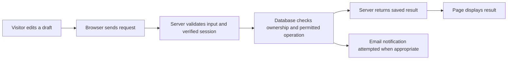

This integration branch is documented in [CONSOLIDATION.md](CONSOLIDATION.md). Older two-app paths below describe the pre-cutover production architecture.

# Start here: understanding the AVES code

This guide is for Martín and anyone new to coding. Read it once, then follow the file links in the [frontend tour](frontend-code-tour.md). The comments in the source explain the purpose of each section and the less obvious decisions. You do not need to understand every framework implementation to edit a heading or add a sourced bird.

## One website, two applications

Visitors see one site at **https://aves.bio**. Its code currently lives on two independent branches of [mmelendro/Aves](https://github.com/mmelendro/Aves):

| Branch | What it serves | Vercel project |
| --- | --- | --- |
| [webmaster/readiness-2026-11-05](https://github.com/mmelendro/Aves/tree/webmaster/readiness-2026-11-05) | Global homepage, Colombia, New Zealand; forwards shared account pages | v0-company-landing-page |
| [australia/preview](https://github.com/mmelendro/Aves/tree/australia/preview) | Australia, shared contact service, customer accounts, quotes and owner dashboard | aves-australia |

The laptop folders `source` and `australia` are separate checkouts. On GitHub you see the files at the root of the selected branch, **not** inside those two folders. Do not merge the branches: they are different applications. New Zealand is public inspiration in development; it does not yet support saved trips. Future-country entries in the backend do not automatically make those countries bookable.

**My Trips is `/account` for every supported destination.** The account implementation remains in the Australian application. A server rewrite forwards the page while retaining the shared public URL. Older `/australia/account` links redirect. Shared `aves-auth` session cookies use the root `/` path; older cookie migration is handled explicitly. The database is shared by Colombia and Australia, not copied per country.

## What the folders mean

| Folder/file | Plain-language purpose | Typical edit |
| --- | --- | --- |
| `app/` | Pages and server entry points. Folder names usually become URL paths. | Homepage headings and page sections |
| `app/page.tsx` | The application's homepage. | Main welcome message |
| `app/layout.tsx` | The outer frame surrounding all pages. | Fonts, shared page setup |
| `app/regions/[slug]/page.tsx` | One template for many region URLs; `[slug]` is the changing name. | Regional page layout |
| `app/api/.../route.ts` | Server handlers receiving requests, not visible pages. | Backend work, with tests |
| `components/` | Reusable interface pieces imported by pages. | Carousel, map, navigation |
| `components/ui/` | Small shared controls such as buttons and dialogs. | Usually leave alone; see its README |
| `content/` | Public bird, region and page data. | Add a sourced bird or revise a description |
| `public/` | Media served as public files. `public/images/a.jpg` becomes `/images/a.jpg`. | Add a licensed photograph |
| `lib/` | Shared logic and helpers. Australian `lib/` also contains private server operations. | Link rules or validated backend behavior |
| `tests/` | Automated examples of expected behavior and failures to reject. | Verify a meaningful behavior change |
| `supabase/` | Database history and security documentation. | Read the README before doing anything |
| `middleware.ts` | Routing/session work before a page handles the request. | Rarely needed for content work |
| `next.config.mjs` | Framework settings, headers and route behavior. | Hosting/routing changes |
| `tailwind.config.ts` + `app/globals.css` | Shared styles and design tokens. | Brand colours, global styles |
| `package.json` | Dependencies and named commands. JSON does not allow comments. | Dependency maintenance |
| `pnpm-lock.yaml` | Exact dependency versions generated by pnpm. | Let the package tool update it |
| `CONTINUE-HERE.md` | Current release, branch and verification handoff. | Check what is actually published |

`node_modules`, `.next`, `next-env.d.ts` and build information are generated files. They are not the right places to customize AVES. Some older Colombia components remain as optional/historical material; a file existing does not prove the live site uses it. Find its imports before editing it.

## Reading a page without knowing the language

1. **Imports at the top** name the pieces this file uses. `@/` means the root of the current application, not a website address.
2. **Types or interfaces** describe the expected shape of data. They help the editor catch mistakes; they do not validate untrusted internet requests.
3. **Constants** hold reusable values or content. An array `[]` is a list; an object `{}` groups named fields.
4. **Functions** do a job. A React component is a function whose returned JSX describes the interface.
5. **The returned JSX** looks like HTML. Text appears on the page; `{expression}` inserts a calculated value; `className` supplies styling.

This real helper from `lib/utils.ts` shows how to read each line:

```tsx
import { clsx, type ClassValue } from "clsx" // Import a class-name helper and its input type.
import { twMerge } from "tailwind-merge"     // Import the helper that resolves conflicting styles.

export function cn(...inputs: ClassValue[]) { // Export a reusable function; ... collects its arguments.
  return twMerge(clsx(inputs))               // Combine conditional names, then resolve conflicts.
}                                           // End the function; this bracket does not render anything.
```

Common expressions you will see:

| Code | Meaning |
| --- | --- |
| `bird.commonName` | Read one field from a bird object. |
| `birds.map(bird => ...)` | Produce one result or visual item for every bird. |
| `birds.find(bird => bird.id === id)` | Find one bird with the matching stable identifier. |
| `items.filter(...)` | Keep only items that match a condition. |
| `{...bird, localOccurrence: note}` | Copy the bird's fields, replacing the local note. |
| `audioFile?: string` | This field is optional. A missing recording is valid. |
| `bird?.image` | Read image only if bird exists. |
| `value ?? fallback` | Use a fallback only when value is null or undefined. |
| `value \|\| fallback` | Use a fallback for any false-like value, including an empty string. |
| `condition ? yes : no` | Choose one of two alternatives. |
| `condition && <Panel />` | Render the panel only when the condition is true. |
| `await operation()` | Wait for an asynchronous operation, such as a server response. |
| `try / catch / finally` | Attempt work, handle failure, and optionally clean up regardless. |
| `export` | Make this value/function available to other files. |
| `// ...`, `/* ... */`, `{/* ... */}` | Developer comments; the JSX form is used inside returned markup. |

## How interactions work

`"use client"` marks a component that needs browser-side interaction; it does **not** make its contents private. Initial HTML can still be rendered on the server. Never put a secret in a client component or a `NEXT_PUBLIC_` variable.

`useState` remembers a changing value and gives you a setter. For example, the carousel keeps the selected bird index; clicking Next changes the index and React redraws the relevant UI. `useRef` keeps a handle to an actual image/audio element or a value that should not itself trigger a redraw. `useEffect` synchronizes with browser behavior, such as a timer or media listener; its cleanup removes that work when it is no longer needed. `useCallback` keeps a function's identity stable when a child uses it as an effect dependency.

The carousel's current image, sound, details and slideshow are separate states. Selecting a new bird stops the old recording. Sound starts only through a visitor action. The portrait image frame is **9:16, up to 320 pixels wide**; `object-cover` fills it by cropping the photograph, and `imagePosition` chooses the focal point. There is no duplicated blurred image filling the sides. The info button reveals range/habitat and a separate expandable credits section. `onBirdChange` lets the adjacent map highlight a relevant planning area; this is not a full species distribution map.

## Understanding the styling

Tailwind classes are small styling instructions. `grid` creates a grid; `gap-6` adds space between items; `rounded-2xl` rounds corners; `text-emerald-700` chooses a green text colour. `lg:grid-cols-2` uses two columns on large screens. Unprefixed classes apply first, and breakpoint classes adapt them to wider screens. `hover:` is for pointing devices, `focus-visible:` supports keyboard users, and `motion-reduce:` respects reduced-motion preferences.

Accessible names such as `aria-label` describe icon buttons for assistive technology. `sr-only` keeps explanatory text available to screen readers without showing it visually. Keep these even when the visible design is minimal. Form labels, focus outlines, keyboard handlers and touch target sizes are functional parts of the design.

## How a private trip request works



The browser must not decide who owns a record or who is an administrator. The server derives identity from the verified session; database permissions and row-level rules provide another layer. A public Supabase publishable/anonymous key is different from a private server secret. Private keys stay in hosting configuration or untracked local environment files.

An **idempotency key** identifies a particular submission so an unchanged retry does not create a second request. A **revision** detects another edit made while a form was open. A **quote snapshot** preserves what the traveller submitted. A stored request is not a booking; an issued proposal is not a payment; a provider accepting an email does not prove inbox delivery. The Australian [backend tour](https://github.com/mmelendro/Aves/blob/australia/preview/docs/backend-code-tour.md) follows these operations through the actual files.

## Small edits to start with

**Change a heading:** select the correct branch, open the page identified in the frontend tour, edit only the quoted text/JSX sentence, then preview desktop and mobile. Keep truthful destination status and credits.

**Add a bird:** read `content/README.md`; use a unique stable ID, verified distribution and a licensed photo. Add corresponding credits and a region selection where supported. A species source link is not permission to reuse its media. Verify both the portrait crop and audio controls. Do not invent a recording when none is available.

**Add a country:** a public destination card/page and an enabled account destination are separate changes. Saved trips need matching validation, database catalogue entries, consent wording, owner workflows and tests. New Zealand currently remains at the public-inspiration/inquiry stage.

**Change a style:** first prefer the specific page/component. Shared UI primitives affect many pages, and account routing/security files affect behavior beyond appearance.

## Checking and saving your work

Follow [CONTRIBUTING.md](../CONTRIBUTING.md) for the actual local and release commands. Select the correct branch before editing. Inspect the diff, run its tests and strict type check, then preview changed pages. GitHub commits save code online; they do not automatically publish this site. Both Vercel projects currently use deliberate deployments. Do not enable automatic Git deployment or merge the two branches casually.

The comments explain intentions and flow, not a security certification or proof that every historical claim is current. Build output, third-party dependencies, generated geographic coordinates and immutable old migrations are explained in their guides instead of adding a repetitive comment to every literal. When code behavior changes, update the nearby explanation as part of the same edit.
