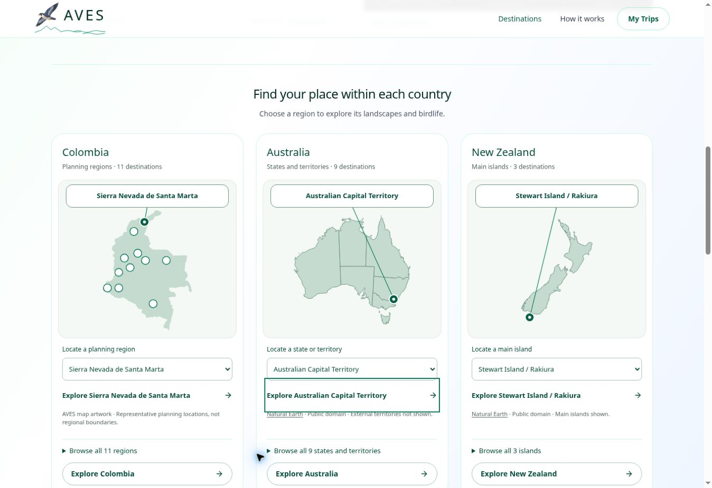

# AVES-012c homepage map cards: published checkpoint

9 November 2026. Published at https://aves.bio/ and paused after GitHub sync.
Application commit: `c3d911db22664fd5287ef0904dc23ebcdd78e3ed`.
Production: `dpl_BDLchEMBuMcTAkyiifguNG7ahjB5`, READY.
Verified Preview: `dpl_Ec7PpE2kXeLQF69erGkVhq2B8NDJ`, READY, same source commit.

## Delivered

The three homepage country cards share full-name location callouts, native
selectors, expandable guide lists, sage/emerald colours, selected markers, frames,
credits and navigation. All 11 Colombian planning regions, nine Australian
states/territories and three NZ islands retain their original URLs. Colombia uses
its existing artwork outline and marker positions with an explicit representative
locations caption. Existing geography/aspect ratios are preserved. No new routes,
packages, private data or services were introduced. The connected hero renderer
and Australian app code remain unchanged.

## Verification

- Node 22 production build, strict TypeScript and all 121 automated tests passed.
- Authenticated Preview review passed at desktop 1363 CSS px. All 23 region
  choices updated the full-name callout and correct Explore target. All three
  cards had equal dimensions with lists closed. Long-name cases included Sierra
  Nevada de Santa Marta, Australian Capital Territory and Stewart Island / Rakiura.
- At 340 CSS px, all three cards fit a single column without horizontal page
  overflow. Native selectors are 44px high. Keyboard Home/ArrowDown/Tab changed
  the selection and matching callout on each card. The full-name guide list also
  opened through Enter. These native controls provide alternatives to small SVG
  markers. This was browser zoom/reflow testing, not device emulation.
- Exact 390/320px emulation and physical touch/iPhone testing were unavailable:
  browser DevTools is administrator-disabled and the documented browser API has
  no viewport resize. Do not claim those checks passed. A 272px stress check
  kept cards within their column but exposed existing header navigation overflow,
  outside the requested 320px minimum; header work was not bundled here.
- Existing connected hero: all three country controls switched the matching
  heading and bird collection. Back to world and direct Australia map selection
  worked. No hero source was edited.
- The normal Production build of the same source commit reached READY. The
  Preview artifact itself was not promoted: changing persistent domain
  auto-assignment was rejected by automatic approval, so that setting was left
  alone. Production was built only after the Preview review.
- Live homepage shows three new cards and correct canonical. Long-name selection
  and Explore URLs passed live. Actual browser navigation opened Colombian Sierra
  Nevada, Australian Capital Territory through the existing Australian app, and
  New Zealand's retained Rakiura anchor.
- Live 340px reflow also passed: no horizontal overflow, full-name callouts and
  44px native selectors. Desktop screenshot is saved with this checkpoint.
- All 26 unique live country/region targets returned HTTP 200 after publication;
  retained NZ North Island/Rakiura anchors exist.
- Human sitemap `/site-map` returned 200. Source XML sitemap has 42 unique URLs;
  Australia's separate `/australia/sitemap.xml` has 32. The former contains
  Colombia/NZ and the latter Australia, reflecting the existing two-app split.
  Neither XML exposes account/admin/API paths. Routes and inventories did not
  change, so no new sitemap entries or fabricated last-modified dates were added.

## Boundaries and next work

No database, AI, billing, credentials, privacy or app-consolidation changes.
No temporary bearer share URL was created and deployment protection stayed on.
The prior authentication blocker is resolved through normal account sign-in.

AVES-012c's homepage pilot is published. Country/subregion template rollouts
remain separate increments. Owner's new request is retained as AVES-062:
main birding sites, intervening towns/cities and estimated travel times for each
subregion, with Google Maps integration. See AVES-062-SUBREGION-ROUTE-PLANNING.md.
It is queued, not implemented, and does not authorize new spending.

