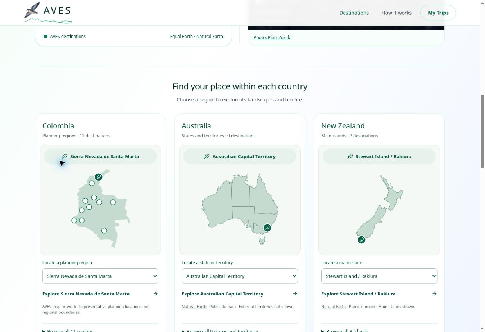

# Homepage map correction after owner mobile review

9 November 2026. Supersedes the visual treatment in the first homepage-card release.
Runtime `6f123b0dcd7d6e4a9d0718a5aff4a798c4d254a5`.
Preview `dpl_2DFJxHwasXVQWTvm3Md44fTnLp47`, READY.
Production `dpl_9bzZ17LFvxTSR8Dr5c2gYPPAfPYV`, READY and published at https://aves.bio/.

The owner's phone screenshots showed two separate homepage map presentations:
old numbered/shaded connected Colombia map and the new card's diagonal connector.
The connector crossed unrelated markers. The first pilot's claim of consistency
applied only to its three cards, not the connected map. This correction includes
both homepage presentations; country/subregion page rollouts remain separate.

## Changes

- Removed the three card connector lines entirely. Selected-region names now sit
  in a feather-accented sage label in normal document flow, above the map. Text
  cannot be covered by map geometry, and there is no line through other markers.
- Introduced one shared decorative feather selection marker, used in all three
  homepage cards and the connected regional maps. Native selectors/full-name links
  remain the primary alternatives to small map shapes.
- Connected Colombian map now uses the same flat sage palette and feather cue
  instead of numbered points. Original marker coordinates and artwork geometry
  remain intact. The optional flat palette is used only by this homepage view.
- Connected Australian map no longer shows abbreviations or tiny-territory leader
  callouts. Connected NZ map no longer uses its old leader/callout treatment.
  Both retain full accessible region names, native selection, real paths, selected
  land highlighting and zoom. Feather sizes compensate for SVG regional zoom.
- No country/account app merge, paid service, database, private data or route change.

## Verification

Node 22 production build, strict TypeScript and all 122 tests pass. The added
regression check verifies full-name region callbacks and feather cues in all three
connected map views, while existing tests protect guide links.

Protected Preview reviewed at 1363px desktop and 340px zoom/reflow. All 23 card
selections update the correct label. Long labels (Sierra Nevada de Santa Marta,
Australian Capital Territory, Stewart Island / Rakiura) have no horizontal overflow
or overlap with the map. Native selectors remain available. For each country,
selecting an actual region filters the matching bird collection/heading, retains
regional zoom, and Back to world works. Original world-map leader labels are
separate contextual geography and were not changed.

Exact 320/390px and physical phone/touch testing remain unavailable in this browser.
Do not describe reflow testing as physical-device emulation.

## Published verification and pause

The normal Production build used the exact same source commit as the verified
Preview. Live homepage shows feather cues and zero card connector lines. Live
region selection/filtering/return passed for Colombia/Eastern Andes,
Australia/Australian Capital Territory and NZ/Rakiura. At 340px, all three cards
have 44px selectors, no callout overflow and no horizontal page overflow.

All 26 country/region link targets returned HTTP 200; retained island anchors
exist. Human sitemap returned 200. XML sitemaps retain 42 source-app and 32
Australian URLs, with no duplicates or account/admin/API entries. Route inventories
are unchanged. GitHub source and checkpoint synced, then paused.

AVES-062 Google Maps/site/town/travel-time work remains queued. No new spending,
AI retries, private guest data, app consolidation or country/subregion template
rollout was included.

