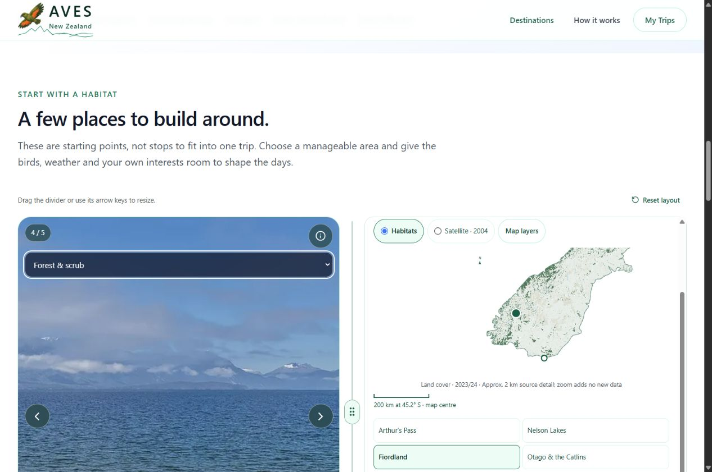

# South Island shared discovery pilot — 9 November 2026

## Scope and source

Selecting one of the four featured landscape places from either map updates the selected place, landscape photograph, both map headings/pins/camera targets and broad bird-habitat filter through one page-local reducer. Habitat selection from either carousel/map chooses a matching landscape in the same state update. All habitats restores30 featured birds while retaining the chosen place/photo. The landscape viewer keeps all five existing licensed photos, including both Arthur's Pass photos. No new range/occurrence claims, media, private data or paid services.

The selected landscape is a public planning reference; bird collections remain sourced South Island HABITAT associations, not species checklists for that particular site. A label makes this distinction explicit. Public park/business/place layers remain their separate curated context previews; this release does not invent matching media for their individual markers or implement continuous world-to-subregion routes, full-screen or soundscapes.

Source a3135c7 adds the shared reducer/provider and connects the bird map's featured-place controls. Follow-up d7e39e5 rounds projected marker coordinates to six SVG decimals, avoiding server/browser trigonometry hydration differences far below source resolution. Existing source geography, rights, calls, layer controls and private wishes are retained. The main source branch is webmaster/readiness-2026-11-05; Australia/account app is unchanged.

## Verification completed locally

-129 automated tests passed,0 failures; TypeScript noEmit passed, including reversible reducer transitions, valid local profile membership, unmodified credits, wrapping, invalid selection handling, preserved matching photos and All reset.
- Browser1280x700,390x700,320x700: all four featured places selected alternately from each map, matching both map headings/selected pins, photo and all habitat selectors; no document horizontal overflow.
- Bird calls play after a visitor action and stop on habitat/collection changes. Kea wish survived habitat changes; no account data submitted. The test wish was browser-local only.
- Landscape arrows retain the second Arthur's Pass photo. Place Info/credits open and close. Keyboard Enter on place controls updates both viewers.
- Satellite selection remains at55% opacity on both maps after place changes; visible ecosystem layers remain enabled. Scales and cameras recenter on the selected reference. All restores30 birds while preserving Fiordland landscape.
- Initial local preview had a stale/corrupt Next development cache. Restarted only the local main-app server; preserved the old cache in the ignored audit workspace. The live site and Australian app were unaffected. A temporary extra preview process was stopped. No cache file is source.

## Published deployment and final gates

Previous main Production:1aed534 / dpl_EpZR2p99nc9zy5gp8z83zpueMCKp. Earlier interim candidate a3135c7 / dpl_AV9rvZ2MN94mbTvQefDbfrLM6eeE was not promoted because browser testing found the precision warning. Corrected source d7e39e5 built successfully and was verified READY as dpl_EmKES8YcrhCjWVz7J3kRmBX3JUgx, https://v0-company-landing-page-djy4kq8u2-mmelendro-9273s-projects.vercel.app. The protected candidate passed all four place transitions at1280/390/320px, with linked map titles/photo/filter checks and no console errors. It was promoted successfully to aves.bio. Live1280/390/320px checks passed for Fiordland, Otago/Catlins and Nelson Lakes respectively, with no horizontal overflow or console errors.

No physical iPhone touch test. Viewport tests cover narrow layout and browser controls, not real hardware. No guest emails, proposals, bookings, database mutations, authentication changes or new spending. AI remains deferred. All34 live route/image checks passed: homepage, three countries, South Island, all11 Colombia and9 Australia regional pages, both human/XML sitemaps and five landscape assets. Canonical URL and NZ anchor IDs are present; private account/admin/API routes remain excluded from XML sitemaps. Routes/hierarchy are unchanged, so no fabricated sitemap date or new route was added.

## Evidence and continuation

Recovery source branch checkpoint/2026-11-09-07-south-island-discovery points to d7e39e5. The previous deployment is retained above; use the normal exact-deployment rollback if needed, then re-verify public pages. This UI-only release has no database rollback. Working source and documentation are synced to GitHub. Pause before the next step. Next proposed small release: full-screen South Island bird/place viewing preserving selection, controls, credits, Close/Escape and focus restoration; not implemented here.
