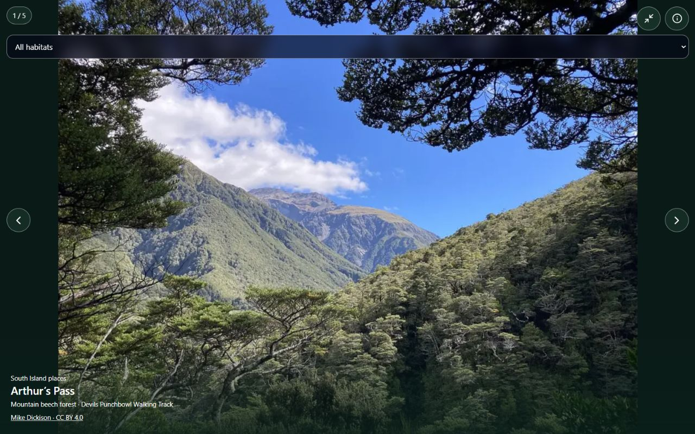

# South Island full-screen media pilot — 9 November 2026

Runtime `4aa0939`, Production `dpl_31oP6mrnBhN8MW5CbTZCXXaVNLQz`, https://v0-company-landing-page-aokag5h98-mmelendro-9273s-projects.vercel.app. Published to https://aves.bio/new-zealand/south-island after the exact READY candidate was tested. Previous deployment `dpl_EmKES8YcrhCjWVz7J3kRmBX3JUgx` / source `d7e39e5` remains available as checkpoint07.

The South Island bird and landscape viewers have discreet expand/collapse controls. A shared native-dialog wrapper moves the same viewer into the browser top layer, retaining selected slide, Info and current call playback rather than creating another carousel/audio instance. Complete existing photographs use contain/centred presentation in the expanded frame; closing restores the normal portrait crop. Existing arrows, habitat selector, credits and bird wishes remain. Native modal focus containment, Escape/Close, trigger focus restoration and page scroll locking are included. No new media, dependencies, routes, database changes or paid services.

Verification:129 automated tests passed; TypeScript passed; hosted production build READY. Local desktop1280 and phone390/short320 layouts checked, including scrollable Info, no horizontal overflow, retained slide/focus and call continuity. Exact candidate checked at requested desktop/phone sizes, including expanded habitat changes and calls continuing through close. Cookie prompt initially blocked a candidate interaction; rejected non-essential cookies and repeated the check successfully. No candidate/live console errors observed. Live desktop and measured390px phone-viewport expand/close and complete-image fit checked for both viewers, with no horizontal overflow. Nine public routes/sitemaps returned200; both XML sitemaps exclude account/admin/API routes. Site hierarchy is unchanged; no artificial sitemap dates added. Physical iPhone touch/Safari gestures are unverified. Full-screen maps, pinch photo zoom and other-country rollout remain separate work.

## New owner requirements and next priorities

1. Next media increment:036/053 South Island resource carousel with embedded podcasts/compatible videos and discreet bird-inspired player. Start with one verified publisher-supported embed and link fallback; retain required publisher controls, attribution and privacy-aware loading. Integrate optional habitat soundscapes/call/video coordination later in small steps. No autoplay sound or new spending.
2.061 South Island/New Zealand logo landscape contour extended toward the menu/right edge, bird-inspired, responsive and clear of navigation. Keep thin wordmark and links. Pilot separately.
3.063 save parks, conservation organisations/projects, birding lodges and other public places alongside bird wishes in the private brief. Review/remove, authenticated save/reopen/edit and explicit owner sharing; server validation and owner-only access. No implied partnerships/bookings. Complete acceptance is in NEXT-WEEK-PROMPT.md. Recorded, not implemented.

Pause before the next increment. Recovery checkpoint08 points to runtime4aa0939. Documentation commits are newer than the deployed runtime. Australia/shared accounts remain unchanged.
