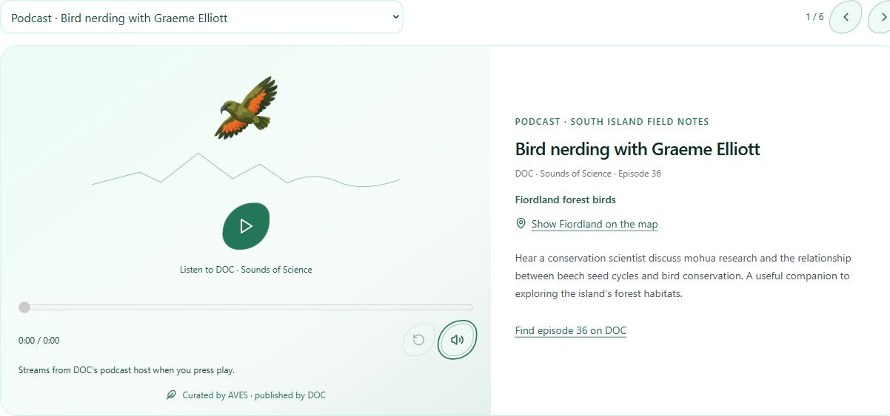

# South Island embedded resources — 9 November 2026

Final source runtime `bf49517`, Vercel `dpl_CD46PdiKxApLx6ZvQhcJiFVd11Q1`, https://v0-company-landing-page-fs9jgrp4r-mmelendro-9273s-projects.vercel.app. Initial resource runtime `ad9f263` / `dpl_2fGYPeb3prBqttGsHudhkqcvKnYQ` was published before the owner requested guidebook links; the final build adds those two links. Main app branch `webmaster/readiness-2026-11-05`; Australia/shared accounts unchanged. Promotion/live checks are recorded below after completion.

## Delivered scope

Replace six text cards with one manually navigated carousel: two DOC Sounds of Science podcasts, the first Fiordland Kiwi Diaries episode, DOC’s Kākāpō Cam highlights playlist, and the two retained reading resources. Native podcast controls offer play/pause, loading cancellation/retry, seeking, fifteen-second rewind and mute; familiar controls use a restrained feather outline. The existing AVES kea brand artwork replaces the generic bird, matching the South Island/regional identity. This is a South Island pilot, not a global player rollout.

Podcasts stream from DOC’s publicly linked feed enclosures. Audio has no src until Play; no recording is copied to AVES. YouTube privacy-enhanced frames load only after Load DOC video, with native publisher playback/captions/full-screen controls and no autoplay. Publisher links remain visible for blocked/unavailable embeds and reading resources. Switching slides removes the previous player; a bird call pauses podcasts and unloads video, and starting a resource stops existing native audio. No new SDK, secret, paid service or security-header relaxation. Habitat soundscapes/ducking, transcripts beyond publisher resources, arbitrary external embeds and the logo-to-menu landscape line remain separate work.

Owner follow-ups included: use the regional kea rather than a generic bird; add sourced location actions. Show Fiordland on the map selects the shared Fiordland place, moves both maps/photo/habitat state and jumps to a stable main-map anchor. Arthur’s Pass and Nelson Lakes reading have matching actions. Whenua Hou footage remains explicitly offshore and has no misleading mainland marker. Place associations live with the curated resource records, not a catch-all guess.

## Source verification

- DOC podcast page https://www.doc.govt.nz/news/podcast/ links https://feeds.blubrry.com/feeds/doc_sounds_of_science.xml. Feed titles/enclosures checked for episode36 (Graeme Elliott) and26 (Tim Raemaekers part2). Both hosts returned206 audio/mpeg with byte ranges. Native playback was observed advancing for both episodes locally.
- Official documentary page https://www.doc.govt.nz/fiordland-kiwi-diaries embeds JgVM3Y_3400, i8mbfjyz4w0 and DQILKrjDUYc. Pilot embeds episode1; original series page retains access to all three.
- https://www.doc.govt.nz/kakapocam links playlist PLL6KEl0oZPfs0SbJnJX9c7ah4cZe03BaP. Verified embedded playlist loads the DOC channel’s Rakiura nest highlights. This is recorded offshore footage, not an ordinary South Island access promise.
- Embed behaviour follows https://developers.google.com/youtube/player_parameters. Player viewport retains minimum200px height, publisher controls and original-source links. Ownership/availability remain with publishers; AVES does not claim the material as its own.

## Verification

132 automated tests passed; TypeScript passed; hosted build READY. Tests preserve six resources, valid public source/player hosts, unloaded SSR media, unique IDs and reviewed place associations, including excluding offshore footage from mainland map actions. Browser checks cover desktop1280, phone390x844 and short343x480 CSS viewports; browser zoom was accounted for using measured innerWidth. No physical iPhone/Safari hardware test. All six selections remain reachable, no horizontal overflow; keyboard Enter navigation, podcast seek/mute/pause, load/unload video with focus restoration, real audio advancement, and Fiordland map linkage checked. Cookie rejection precedes candidate checks. Source-page automated HTTP fetch initially returned403; ordinary browser inspection plus the public RSS feed verified the exact media; no access protection was disabled.

Previous main Production:4aa0939 / dpl_31oP6mrnBhN8MW5CbTZCXXaVNLQz, retained in checkpoint08. Recovery for this release is checkpoint09. Routes/hierarchy are unchanged; verify human/XML sitemaps rather than fabricate lastmod updates. No personal trip submissions, emails, proposals, account permissions or database changes in this release.

## Guidebook follow-up and remaining owner ideas

Two expandable field-guide purchase entries are present below the player: Penguin’s The Hand Guide to the Birds of New Zealand (Heather/Robertson, illustrated by Onley; ISBN9780143570936), and Auckland University Press’s Birds of New Zealand: A Photographic Guide (Scofield/Stephenson; ISBN9781869407339). Publisher pages verified9November2026 and retain purchase/bookshop options. No copied cover art, prices, stock promises or affiliate parameters. Clients compare editions/shipping with the seller; national book coverage is broader than the South Island/current trip checklist. Existing six carousel resources are retained; this is a compact additional disclosure, not more competing carousels.

During the field-guide edit a local development-generated Next routes definition was briefly incomplete; rerunning TypeScript after generation settled passed, with no source exclusions or manual generated-file changes. Final clean hosted build also succeeded. Final candidate desktop and390px expanded-guide layouts passed without horizontal overflow; both exact source URLs are present. The core player candidate also passed short343x480 layout and132 automated checks after the guide addition.

064 biological/ecological/historical orientation is QUEUED in NEXT-WEEK-PROMPT.md and AVES-CHANGE-INBOX.md, not implemented here.061 logo-to-menu landscape line and063 saved places also remain queued. Habitat soundscapes053 are still unimplemented; this release is the embedded resource/player pilot036, not the entire audio programme.

## Final publication

Final bf49517 build verified READY as dpl_CD46PdiKxApLx6ZvQhcJiFVd11Q1 and promoted to aves.bio. Live390px guide disclosure has both publisher links, kea identity and no horizontal overflow; documentary map action sets both map headings to Fiordland. Nine live routes returned200: homepage, Colombia, Australia, New Zealand, South Island and both apps’ human/XML sitemaps. XML maps still exclude private account/admin/API routes. No new routes or hierarchy, so sitemap checks required no invented dates. Candidate browsers had no console errors. Live podcast activation connects to the exact publisher enclosure only on request; playback advanced past53 seconds with readyState4 and the expected2755-second episode duration. Candidate documentary playback advanced past23 seconds with readyState4.

Source and documentation synced to GitHub; checkpoint/2026-11-09-09-south-island-resources records bf49517. Pause before061 or any other queued feature. New064 context/history requirement is recorded, not shipped.
