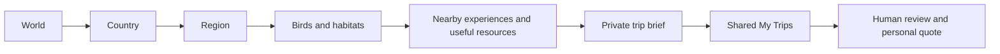

# AVES — visual site architecture

**Current release — 9 November 2026: published and paused.** South Island/regional zoom is live: source5847eb7 / dpl_GMPLFwPviWsLq73i9JJBjCNvkaja; AU6ba7fee / dpl_9ZrHC1jyd3SGzMeVn248kcFBwmcv. Desktop/mobile and live sitemap checks passed within the limits recorded in [RELEASE-2026-11-09-SOUTH-ISLAND.md](RELEASE-2026-11-09-SOUTH-ISLAND.md). A1 is complete; B1 private-brief verification is the next proposed increment, not started. Announce model/effort before resuming; Sol medium recommended. This notice overrides older staged/paused status below.

Design/source snapshot: 9 November 2026 (Sydney). **Planning only; no navigation or sitemap interface has been deployed by this update.** Public registry data was inspected locally today. Provider/live status remains the 8 November checkpoint; the new South Island route was published and verified live 9 November. See AGILE-PLAN for sequencing and the mandatory deployment sitemap gate (033).

## Read the two dimensions

Vertical nesting below describes the visitor's information hierarchy, not a proposed URL rename. Existing Colombian region URLs stay under /regions; Australian URLs include /australia. Regions are planning regions, states/territories or islands as appropriate, not interchangeable boundary claims.

Horizontal journeys cross that hierarchy:

Related links express those journeys; they do not create duplicate pages or expose private records. Photos and maps are two ways into the same place/species content. The public expandable directory should show only useful cross-links, not an all-to-all diagram.

## Expandable public page tree — design preview

The lists below are generated from the inspected lib/public-pages.ts registries, then grouped by visitor context. They are a documentation snapshot, not a third runtime catalogue. Refresh from those registries when routes change. Until 033b ships, the human sitemap still uses grouped cards. Its future tree should reuse those same route records and minimal parent/related metadata.

AVES — all destinations

- [Global homepage / world explorer](https://aves.bio/)
- [Human site map](https://aves.bio/site-map)

Colombia

Overview, birdlife and trip planning

- [Colombia Home](https://aves.bio/colombia)
- [Explore the Regions](https://aves.bio/aves-explorer)
- [Colombian Birdlife](https://aves.bio/species)
- [How It Works](https://aves.bio/how-it-works)
- [Plan My Colombia Trip](https://aves.bio/contact)

Colombian Regions

- [Pacific](https://aves.bio/regions/pacific)
- [Western Andes](https://aves.bio/regions/western-andes)
- [Central Andes](https://aves.bio/regions/central-andes)
- [Eastern Andes](https://aves.bio/regions/eastern-andes)
- [Cauca Valley](https://aves.bio/regions/cauca-valley)
- [Magdalena Valley](https://aves.bio/regions/magdalena-valley)
- [Caribbean](https://aves.bio/regions/caribbean)
- [Sierra Nevada de Santa Marta](https://aves.bio/regions/sierra-nevada-de-santa-marta)
- [Llanos](https://aves.bio/regions/llanos)
- [Amazonia](https://aves.bio/regions/amazonia)
- [Colombian Massif](https://aves.bio/regions/colombian-massif)

Colombia Birding Experiences

- [Birding Experiences](https://aves.bio/tours)
- [Adventure Tours](https://aves.bio/tours/adventure)
- [Vision Tours](https://aves.bio/tours/vision)
- [Elevate Tours](https://aves.bio/tours/elevate)
- [Souls Tours](https://aves.bio/tours/souls)
- [Sierra Nevada Birding Experience](https://aves.bio/tours/adventure/sierra-nevada)

Colombia Reading & Planning

- [Birding Blog](https://aves.bio/blog)
- [Hummingbird Sanctuaries](https://aves.bio/blog/hummingbird-vision-journey)
- [Sierra Nevada Birding](https://aves.bio/blog/sierra-nevada-indigenous-birding)
- [Páramo & Cloud Forests](https://aves.bio/blog/paramo-manizales-thornbill)
- [Chocó Birding](https://aves.bio/blog/choco-toucan-expedition)
- [Birding Resources](https://aves.bio/resources)
- [Travel Tips](https://aves.bio/travel-tips)

About AVES Colombia

- [About AVES Colombia](https://aves.bio/about)
- [Our Team](https://aves.bio/team)
- [Our Partners](https://aves.bio/about/partners)
- [Our B Corp Journey](https://aves.bio/about/b-corp)
- [Responsible Birding](https://aves.bio/conservation)

Australia

Start Exploring

- [Australia Home](https://aves.bio/australia)
- [Explore the Regions](https://aves.bio/australia/aves-explorer)
- [Australian Birdlife](https://aves.bio/australia/species)
- [How It Works](https://aves.bio/australia/how-it-works)
- [Plan My Trip](https://aves.bio/australia/contact)

Australian Regions

- [Queensland](https://aves.bio/australia/regions/queensland)
- [New South Wales](https://aves.bio/australia/regions/new-south-wales)
- [Tasmania](https://aves.bio/australia/regions/tasmania)
- [Victoria](https://aves.bio/australia/regions/victoria)
- [South Australia](https://aves.bio/australia/regions/south-australia)
- [Western Australia](https://aves.bio/australia/regions/western-australia)
- [Northern Territory](https://aves.bio/australia/regions/northern-territory)
- [Australian Capital Territory](https://aves.bio/australia/regions/australian-capital-territory)
- [Jervis Bay Territory](https://aves.bio/australia/regions/jervis-bay-territory)

Birding Experiences

- [Birding Experiences](https://aves.bio/australia/tours)
- [Adventure Tours](https://aves.bio/australia/tours/adventure)
- [Vision Tours](https://aves.bio/australia/tours/vision)
- [Elevate Tours](https://aves.bio/australia/tours/elevate)
- [Souls Tours](https://aves.bio/australia/tours/souls)

Reading & Planning

- [Australian Notes](https://aves.bio/australia/blog)
- [Birding Resources](https://aves.bio/australia/resources)
- [Travel Tips](https://aves.bio/australia/travel-tips)

About AVES

- [About AVES Australia](https://aves.bio/australia/about)
- [Our Team](https://aves.bio/australia/team)
- [Our Connections](https://aves.bio/australia/about/partners)
- [Our B Corp Journey](https://aves.bio/australia/about/b-corp)
- [Responsible Birding](https://aves.bio/australia/conservation)

Website Information

- [Privacy](https://aves.bio/australia/privacy)
- [Terms](https://aves.bio/australia/terms)
- [Cookies](https://aves.bio/australia/cookies)
- [Photo & Sound Credits](https://aves.bio/australia/credits)
- [Site Map](https://aves.bio/australia/site-map)

Aotearoa New Zealand

- [New Zealand — In Development](https://aves.bio/new-zealand)
- [South Island — Birdlife & Trip Planning](https://aves.bio/new-zealand/south-island) **Published 9 November 2026.**
- [North Island — current country-page section](https://aves.bio/new-zealand#region-north-island); dedicated guide **planned**, URL not assigned by this document.
- [Rakiura — current country-page section](https://aves.bio/new-zealand#region-rakiura); dedicated guide **planned**, URL not assigned by this document.
- [South Island practical planning — in-page section, published9 November](https://aves.bio/new-zealand/south-island#practical-planning). Curated resources remain a planned content expansion; no separate resource route assigned.

Global website information and credits

- [Privacy](https://aves.bio/privacy)
- [Terms](https://aves.bio/terms)
- [Cookies](https://aves.bio/cookies)
- [Photo & Sound Credits](https://aves.bio/credits)
- [Site Map](https://aves.bio/site-map)

## Shared private journey — not an indexed branch

- Shared [My Trips entry](https://aves.bio/account) is the generic sign-in/private-workspace doorway across all destinations, not a public list of clients or itineraries.
- Existing private drafts, wishlist selections, questionnaire answers, explicit requests and owner-priced proposals remain access-controlled. No personal content belongs in this document, the public tree, XML or logs.
- A public directory may link the generic My Trips doorway separately from its SEO-page inventory. Do not enumerate owner/admin tools or private record URLs publicly. Sitemap omission/robots are not access controls.

## Planned directory presentation and release checks

Keep country names visible; expand to regions and related pages with nested lists/disclosures, full region names and a clear current-page cue. Use the AVES emerald style and small cross-link rows, not a heavy graph library. Desktop may align branches in columns; phones need a readable vertical stack with keyboard/touch disclosure and no horizontal overflow.

For every deployment: compare canonical public routes and registry; refresh this snapshot/visible directory when structure changes, otherwise mark checked/unchanged; test links/parents, canonicals/redirects/Australian base path and private-route exclusion; check human and XML views on stage/live. No false lastModified dates. Planned nodes stay out of public navigation until available; newly published South Island must lose its staged badge in this planning snapshot.

Search-engine inventories remain separate from this visual hierarchy: [AVES XML](https://aves.bio/sitemap.xml) and [Australia XML](https://aves.bio/australia/sitemap.xml). Existing tests already validate canonical uniqueness, region coverage, private exclusions and base paths. Add only missing route/hierarchy drift checks when implementing 033b; no application changes are made by this planning artifact.
